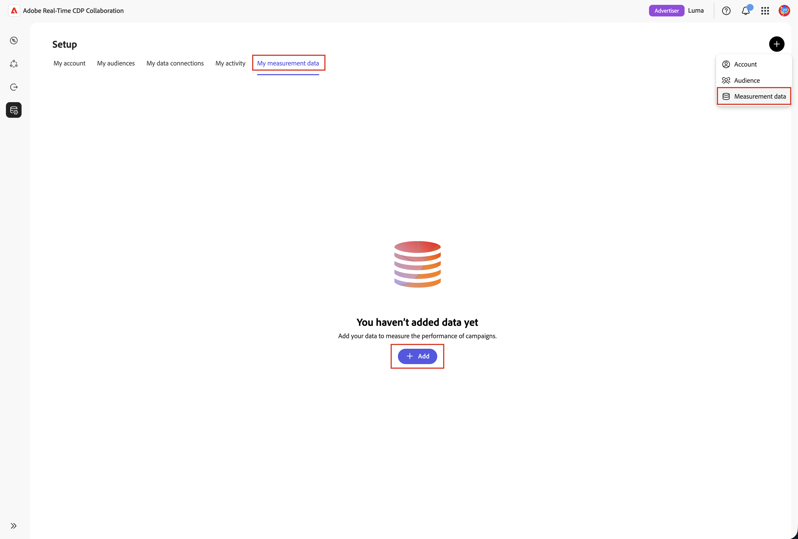
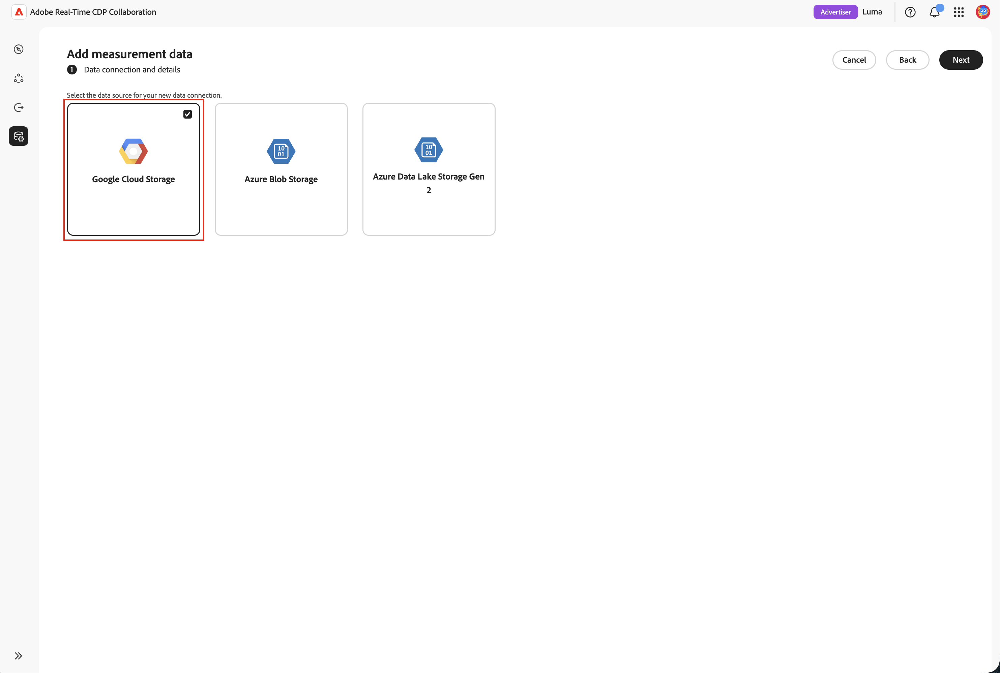
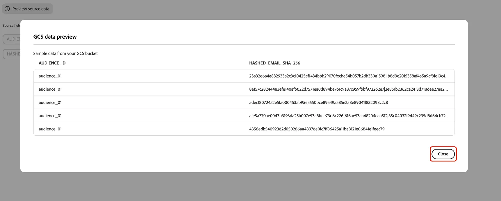

# 광고 노출 소싱을 위한 [!DNL Google Cloud Storage] 구성

측정을 위해 [!DNL Google Cloud Storage]&#x200B;(GCS) 버킷을 Adobe Real-Time CDP Collaboration에 소스 광고 노출(광고 로그) 데이터에 연결합니다.

Real-Time CDP Collaboration의 측정 모듈은 광고주 전환 데이터를 게시자 광고 노출 로그와 연결하여 개인 정보 중심의 캠페인 보고를 제공합니다. 광고주 및 게시자를 위한 셀프서비스 비코드 경로가 추가됩니다. [!DNL Google Cloud Storage]에 이미 보관하고 있는 광고 노출(노출) 로그를 Adobe Experience Platform 종속성 없이 속성을 위해 측정으로 가져올 수 있습니다. 버킷을 연결하고 감지된 데이터가 측정 도구에서 예상하는 광고 로그 스키마와 일치하는지 확인한 다음 몇 분 안에 완료합니다.

연결 시 데이터를 가져오지 않습니다. 소싱은 측정 보고서를 실행할 때 트리거됩니다. 스토리지를 최소화하기 위해 Adobe은 7일 보존 기간 후에 소스 광고 로그를 자동으로 삭제합니다.

[!DNL Google Cloud Storage]에서 가져온 광고 로그에 대한 거버넌스 및 데이터 처리 규칙이 Adobe Experience Platform에서 가져온 데이터에 적용되는 규칙과 일치합니다.

>[!NOTE]
>
>이 안내서에서는 클라우드 스토리지의 소싱 광고주 및 게시자 **광고 로그**(광고 노출)를 다룹니다. 클라우드 스토리지의 소싱 전환 데이터가 곧 제공될 예정입니다.

## 사전 요구 사항 {#prerequisites}

구성 워크플로를 시작하기 전에 이 섹션의 모든 항목을 완료하십시오. 이 안내서를 따르려면 먼저 [계정 온보딩 및 설정](./onboard-account.md)을 완료해야 합니다.

### GCS 액세스 및 권한 {#gcs-access-permissions}

마법사를 시작하기 전에 사용자 또는 [!DNL Google Cloud] 관리자가 Adobe에 GCS 버킷에 대한 읽기 전용 액세스 권한을 부여해야 합니다. 단계별 지침은 [Google 클라우드 저장소 권한 설정](#setup-gcs-permissions)을 참조하십시오.

### 광고 로그 데이터 준비 {#prepare-adlog-data}

소싱이 시작되기 전에 광고 로그 파일이 [광고 로그 스키마](#ad-log-schema)를 준수해야 합니다. 주요 요구 사항은 다음과 같습니다.

* **파일 형식:** CSV만
* **표준 열 헤더:** 파일은 [광고 로그 스키마](#ad-log-schema)에 정의된 표준 열 헤더를 사용해야 합니다. 이 버전은 열별 재매핑 또는 자동화된 스키마 매핑을 지원하지 않습니다.
* **필수 필드:** 일치 키와 함께 모든 필수 필드가 있어야 합니다.
* **일치 키 해시:** 일치 키 해시 값은 소문자로 된 16진수 SHA-256이어야 합니다.
* **열 일관성:** 구성된 경로의 모든 파일은 동일한 열 레이아웃을 공유해야 합니다.
* **하위 폴더:** 파일은 지정된 경로에 직접 배치해야 합니다. Collaboration은 하위 폴더를 트래버스하지 않습니다.

## 마법사에서 광고 로그 연결 {#connect-adlogs}

다음 단계를 사용하여 Collaboration 내에서 GCS 및 로그를 연결합니다.

1. **[!UICONTROL 설정]** 작업 영역에서 **[!UICONTROL 내 측정 데이터]**&#x200B;를 선택한 다음 추가 아이콘을 선택하고 **[!UICONTROL 측정 데이터]**&#x200B;를 선택합니다.

   {zoomable="yes"}

2. **[!UICONTROL 측정 데이터 추가]** 워크플로우에서 **[!UICONTROL Advertising 노출]**&#x200B;을(를) 측정 데이터 유형으로 선택한 후 **[!UICONTROL 다음]**&#x200B;을(를) 선택합니다.

   {zoomable="yes"}

3. 측정 데이터를 가져오려면 **[!UICONTROL 새 데이터 연결 추가]**&#x200B;를 선택한 후 **[!UICONTROL 다음]**&#x200B;을 선택합니다.

   {zoomable="yes"}

4. 새 데이터 연결을 위한 데이터 원본을 선택하십시오. **[!UICONTROL Google 클라우드 저장소]**. **[!UICONTROL 다음]**&#x200B;을 선택합니다.

   {zoomable="yes"}

5. **[!UICONTROL 데이터 연결 추가]** 마법사가 열립니다. **[!UICONTROL Google 클라우드 저장소 연결]** 단계에서 광고 로그 파일이 있는 **[!UICONTROL 버킷]** 및 **[!UICONTROL 경로]**&#x200B;를 제공합니다. 두 필드는 모두 필요하며 구성된 경로의 모든 파일은 하나의 데이터 세트로 처리됩니다.

   {zoomable="yes"}

6. **[!UICONTROL 이름 및 설명]** 단계에서 데이터 연결에 필요한 **[!UICONTROL 데이터 연결 이름]**&#x200B;과(와) 선택적 **[!UICONTROL 설명]**&#x200B;을(를) 제공합니다.

   {zoomable="yes"}

7. **[!UICONTROL 필드 매핑]** 단계에서 검색된 열을 미리 보고 마법사가 올바른 파일을 읽었는지 확인한 다음, [광고 로그 스키마](#ad-log-schema)를 검토하십시오. 여기에는 Measurement가 인식하는 모든 필드, 필수 필드와 선택 사항 필드, 그리고 ID/일치 키로 인식되는 검색된 열이 나열되어 있습니다. 이 단계는 읽기 전용 유효성 검사입니다. 시스템에서 필수 헤더가 있는지 확인하고 필수 필드가 누락된 경우 차단합니다. 이 버전에는 열별 재매핑이 없습니다.

   {zoomable="yes"}

8. **[!UICONTROL 검토]** 단계에서 검토하고 완료합니다. 연결이 해당 상태로 측정 데이터 영역에 표시되며, 첫 번째 측정 보고서가 소스 데이터를 실행할 때까지 **보류 중**&#x200B;으로 유지됩니다.

## 광고 로그 소싱 작동 방식 {#how-it-works}

[!DNL Google Cloud Storage]의 광고 로그 소싱은 대상 소싱에 사용되는 높은 수준의 흐름을 미러링합니다.

1. **클라우드 저장소 연결:** 광고 로그가 들어 있는 버킷에 대한 읽기 전용 액세스를 구성합니다.
2. **스키마 검토 및 유효성 검사:** 시스템이 광고 로그 스키마(폴더, 파일 및 필수 헤더 확인, 읽기 전용)에 대해 파일의 유효성을 검사합니다.
3. **필드 매핑:** 원본 ID 필드는 표준 열 이름을 기반으로 표준 필드에 자동으로 매핑됩니다. 수동 재매핑이 없습니다.
4. **수집 및 표준화:** 이벤트가 노출당 하나의 행으로 표준화되었습니다. 광고 로그 소싱은 측정 보고서를 실행할 때 시작됩니다.

### 광고 로그 스키마(표준 CSV 형식) {#ad-log-schema}

필수 필드가 있어야 하며 다음 표에 **조인 키(필수 중 하나)**&#x200B;로 표시된 필드가 하나 이상 있어야 합니다. 일치 키 해시 값은 소문자로 된 16진수 SHA-256입니다.

| 필드 | 데이터 유형 | 필수 | 설명 |
| --- | --- | --- | --- |
| `EVENT_DATETIME` | 문자열(ISO 8601) | 필수 | 이벤트의 타임스탬프 |
| `EVENT_ID` | 문자열 | 선택 사항입니다 | 이벤트에 대한 고유 ID |
| `EVENT_TYPE` | 문자열(열거형) | 필수 | 이벤트 유형. `{impression, click}` 중 하나 |
| `HASHED_EMAIL_SHA_256` | 문자열(64자 16진수) | 조인 키(필수 항목 중 하나) | 이메일의 소문자 16진수 SHA-256 |
| `HASHED_IPV4_SHA_256` | 문자열(64자 16진수) | 조인 키(필수 항목 중 하나) | IPv4의 소문자 16진수 SHA-256 |
| `DEVICE_ID` | 문자열(64자 16진수) | 조인 키(필수 항목 중 하나) | 장치 광고 ID |
| `DEVICE_ID_TYPE` | 문자열(열거형) | 선택 사항입니다 | `{idfa, gaid, aaid, rida, afai, msai, vida, lgudid, tifa}` 중 하나 |
| `ECID` | 문자열(64자 16진수) | 조인 키(필수 항목 중 하나) | Demdex 기반 ECID |
| `CUSTOM_ID` | 문자열 | 선택 사항입니다 | 게시자/파트너 영구 ID(예: PPID, RampID, Core ID) |
| `ADVERTISER_ID` | 문자열 | 필수 | 광고주에 대한 고유 식별자 |
| `ADVERTISER_NAME` | 문자열 | 선택 사항입니다 | 광고주/브랜드 이름 |
| `CAMPAIGN_ID` | 문자열 | 필수 | 플랫폼별 캠페인 식별자 |
| `CAMPAIGN_NAME` | 문자열 | 선택 사항입니다 | 사람이 읽을 수 있는 캠페인 이름 |
| `PLACEMENT_ID` | 문자열 | 필수 | 배치에 대한 고유 식별자 |
| `PLACEMENT_NAME` | 문자열 | 선택 사항입니다 | 설명 배치 이름 |
| `CREATIVE_ID` | 문자열 | 선택 사항입니다 | 광고 문안의 고유 식별자 |
| `CREATIVE_NAME` | 문자열 | 선택 사항입니다 | 사람이 읽을 수 있는 크리에이티브 이름 |
| `AUDIENCE_ID` | 문자열 | 선택 사항입니다 | 대상 세그먼트 식별자 |
| `AUDIENCE_NAME` | 문자열 | 선택 사항입니다 | 사람이 읽을 수 있는 대상 이름 |
| `DEVICE_TYPE` | 문자열(열거형) | 선택 사항입니다 | `{mobile, desktop, tablet, ctv, dooh, car, in_store, other}` 중 하나 |
| `AD_FORMAT` | 문자열(열거형) | 선택 사항입니다 | `{display, video, native, audio, search, commerce, dooh, other}` 중 하나 |
| `SITE_NAME` | 문자열 | 선택 사항입니다 | 노출이 발생한 네트워크/사이트/앱/게시자 속성 |
| `TEST_GROUP` | 문자열 | 선택 사항입니다 | 리프트 스터디, 테스트/컨트롤, 홀드아웃 그룹용 그룹화 |
| `CUSTOM_DIM` | 문자열 | 선택 사항입니다 | 추가 게시자 차원 |

{style="table-layout:auto"}

>[!NOTE]
>
>`MATCH_KEY_TYPE`이(가) 스키마의 선택적 필드로 포함되므로 시간이 지남에 따라 여러 ID 유형을 동시에 지원하고 일치 키 자격 증명(전자 메일, 전화 또는 CRM)을 v1 계약을 중단하지 않고 유지할 수 있습니다.

### 유효성 검사 요구 사항(v1) {#validation-requirements}

시스템은 사용자가 설정 워크플로우를 완료하기 전에 광고 로그 소스 데이터의 유효성을 검사합니다. 유효성 검사:

* 소스 폴더에는 하나 이상의 파일이 있어야 합니다.
* 파일은 비워 둘 수 없습니다.
* 필수 스키마 헤더가 있어야 합니다.
* 선택적 스키마 필드는 생략할 수 있습니다.
* 필수 필드만 포함하는 파일은 유효합니다.

유효성 검사 오류로 인해 계속 진행할 수 없습니다. 시스템은 데이터 유형, 필드 값, 레코드 완전성, 데이터 품질 또는 자동화된 스키마 매핑에 대한 유효성을 **확인하지 않습니다**. 유효성 검사는 이 초기 릴리스에 대한 폴더, 파일 및 필수 헤더 확인으로 제한됩니다.

## 알려진 제한 사항 {#known-limitations}

[!DNL Google Cloud Storage] 광고 로그 소싱을 구성하고 사용할 때 다음 제약 조건에 유의하십시오.

* **광고 로그만:** 이 연결은 광고주 또는 게시자 광고 로그(광고 노출)를 근원합니다. 변환 데이터는 아직 지원되지 않습니다.
* **지원되는 원본:** [!DNL Google Cloud Storage] 및 [!DNL Azure Data Lake Storage] 또는 [!DNL Azure Blob Storage].
* **파일 형식:** CSV만
* **정식 헤더가 필요합니다.** 이 버전에는 열별 다시 매핑과 지능형/자동 매핑이 없습니다. 파일은 표준 열 이름을 사용해야 합니다.
* **값/형식 유효성 검사 없음:** 필수 열 헤더만 유효합니다. 처음에는 데이터 행이 없을 수 있습니다.
* **만든 후 연결을 편집하지 않음:** 활성 일치 키를 변경하는 등 변경 내용을 적용하려면 새 연결을 만들어야 합니다.
* **경로당 하나의 레이아웃:** 경로에 있는 모든 파일은 하나의 동일한 열 레이아웃을 공유해야 합니다. 혼합 레이아웃은 부분 소싱 실패를 유발할 수 있습니다.
* **하위 폴더를 트래버스하지 않음:** 파일은 지정된 경로에 직접 배치해야 합니다.
* **다음 설정에서 일정이나 전환 확인 시간이 없습니다.** 측정 보고서를 실행할 때 광고 로그 소싱이 시작됩니다. 보고서를 구성할 때 전환 확인 기간을 설정하십시오.
* **광고 로그 데이터 연결 하나:** 한 번에 하나의 광고 로그 데이터 연결만 구성합니다. 측정 보고서는 구성된 연결을 자동으로 사용합니다.

## 문제 해결 {#troubleshooting}

* **연결에 보류 중인 데이터가 표시됨/데이터 없음:** 첫 번째 측정 보고서를 실행할 때까지 필요합니다. 연결 시 데이터가 소싱되지 않습니다.
* 원본 단계에서 **&quot;데이터를 찾을 수 없음&quot;:** 폴더가 비어 있습니다. 계속하기 전에 파일을 추가하십시오.
* **미리 보기에 열이 없습니다.** 파일이 있지만 비어 있습니다(헤더나 콘텐츠 없음).
* **과거 유효성 검사를 가져올 수 없습니다.** 필수 열 헤더가 없습니다. 정식 이름을 사용하여 필수 필드와 일치 키가 하나 이상 있는지 확인하십시오.
* **인식할 수 없는 열:** 비정규 열 이름이 알려진 필드로 선택되지 않았습니다. 표준 형식으로 이름을 변경합니다. 이 버전에는 재매핑이 없습니다.
* **설정 후 소싱이 실패했습니다.** 버킷에 대한 Adobe의 읽기 액세스가 변경되지 않았으며 파일이 구성된 경로에 표준 형식으로 남아 있는지 확인하십시오.
* **보고서 날짜 범위가 완전히 포함되지 않음:** 7일 자동 데이터 만료일을 기억하십시오. 요청한 범위에 대해 7일 넘는 로그를 사용할 수 없습니다.

## [!DNL Google Cloud Storage] 권한 설정 {#setup-gcs-permissions}

Adobe이 GCS 버킷에서 읽을 수 있도록 하려면 다음 권한을 사용하여 사용자 지정 IAM 역할을 만듭니다.

| 사용 권한 | 용도 |
| ------------- | --------------- |
| `storage.buckets.get` | 버킷 메타데이터를 읽습니다. |
| `storage.objects.get` | 개체 데이터 및 메타데이터를 읽습니다. |
| `storage.objects.list` | 버킷의 개체를 나열합니다. |

{style="table-layout:auto"}

해당 지역(NA, EMEA 또는 호주)의 Adobe Google 서비스 계정에 이 사용자 지정 역할을 부여합니다. 이 설정을 완료하려면 **Google Cloud 계정 관리자** 권한이 필요합니다.

## 업그레이드 또는 마이그레이션 고려 사항 {#upgrade-migration}

* 이전에 Experience Platform 또는 Adobe 지원 설정을 통해 온보딩된 고객은 셀프서비스 클라우드 스토리지 경로로 이동할 수 있습니다. 기존 측정 보고서와 흐름은 변경되지 않습니다.
* 광고 로그 파일에 있는 일치 키는 대상 소싱과 마찬가지로 Collaboration 계정에 대해 활성화되어야 합니다.
* 거버넌스 및 데이터 처리 규칙은 Experience Platform에서 가져온 데이터와 일치합니다.

## 다음 단계 {#next-steps}

소싱이 완료되면 측정 보고에 광고 로그를 사용할 수 있습니다.

다른 광고 노출 소싱 방법은 [광고 노출 소싱을 위한 Azure 저장소 구성](./configure-azure-adlog-sourcing.md)을 참조하십시오.
