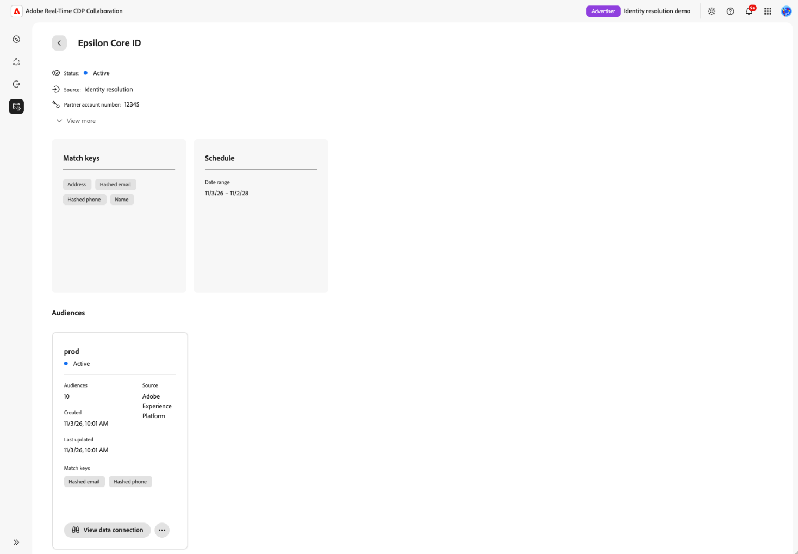

# ID 확인 설정 및 관리

{{limited-availability-release-note}}

조직이 서로 다른 식별자를 사용하는 경우에도 ID 해결을 통해 공동 작업자와 공통으로 가지는 고객을 식별할 수 있습니다. 각 파트너에 대한 사용자 정의 통합을 빌드하지 않고 Real-Time CDP Collaboration에서 지원되는 ID 공급자로 ID 확인을 구성하고 관리합니다.

>[!NOTE]
>
>현재 Epsilon Core ID만 구성에 사용할 수 있으며, 미국에서 프로비저닝된 Real-Time CDP Collaboration 계정에만 사용할 수 있습니다. 이 안내서의 단계 및 스크린샷은 Epsilon Core ID를 사용합니다.

## 사전 요구 사항 {#prerequisites}

시작하기 전에 다음을 확인하십시오.

* **계정 관리 권한** **[!UICONTROL 계정 관리]** 및 **[!UICONTROL Collaboration 인스턴스 관리]** 권한이 있어야 합니다.
* **하나 이상의 대상 데이터 연결입니다.** ID 확인을 구성하려면 기존 대상 데이터 연결이 필요합니다. 필요한 경우 [대상 소싱 설정](./source-overview.md). 측정 데이터 연결은 지원되지 않습니다.
* **지원되는 일치 키 및 필드** ID 확인에 사용할 각 대상 데이터 연결에는 ID 공급자가 지원하는 필드가 포함되어야 합니다. Epsilon Core ID의 경우 해시된 이메일, 해시된 전화 또는 우편 주소와 결합된 이름을 사용할 수 있습니다.

  해시된 이메일 및 해시된 전화기와 같은 계정 수준 일치 키는 계정에 대해 활성화되어야 하며 대상 데이터에 매핑되어야 합니다. 이름 및 우편 주소 필드는 대상 데이터 연결 설정 중에 매핑되며 계정 수준 활성화가 필요하지 않습니다.

  이름 및 우편 주소를 사용하는 경우 각 그룹에서 하나 이상의 필드를 매핑합니다.

  * **이름:** 이름, 성 또는 전체 이름.
  * **우편 주소:** 주소, 구/군/시, 우편번호, 주 또는 국가.

  이름 및 우편 주소 값은 해시되지 않습니다. 해시된 전자 메일 및 해시된 휴대폰과 같은 계정 수준 일치 키를 사용하는 방법에 대한 지침은 [일치 키 편집](./onboard-account.md#edit-match-keys)을 참조하세요. 지원되는 일치 키 또는 이름 및 우편 주소 필드를 대상 데이터에 매핑하려면 [필드 매핑](./onboard-audiences.md#map-fields)을 참조하십시오.
* **Epsilon 계정 번호** Epsilon 계정 담당자에게 Epsilon 계정 번호를 받습니다.

## ID 확인 구성 {#configure-identity-resolution}

ID 공급자를 선택하여 ID 확인 구성을 시작합니다. 이 [!DNL Epsilon Core ID] 예제에서는 공급자를 인증하고, 대상 데이터 연결을 선택하고, 날짜 범위를 설정하고, 구성을 검토한 후 확인합니다.

시작하려면 왼쪽 탐색에서 **[!UICONTROL 설정]**, **[!UICONTROL ID 확인]** 탭을 차례로 선택하여 사용 가능한 ID 공급자를 확인합니다.

### ID 공급자 선택 {#select-identity-provider}

ID 공급자에 대한 카드를 찾고 지원되는 지역 및 일치 키를 검토합니다. 시작하려면 **[!UICONTROL 설치]**&#x200B;를 선택하십시오.

{zoomable="yes"}

구성 워크플로를 시작하기 전에 Collaboration은 데이터 연결 및 호환되는 일치 키를 확인합니다. 요구 사항이 누락된 경우 프로세스를 안내하는 대화 상자가 나타납니다. 대화 상자에서 다음 작업을 수행합니다.

* **[!UICONTROL 데이터 연결 필요]:** 대상 데이터 연결을 구성하려면 **[!UICONTROL 데이터 연결 설정]**&#x200B;을 선택하십시오. [원본 연결](./source-overview.md#connect-a-source)을 참조하세요.
* **[!UICONTROL 일치 키 필요]:** **[!UICONTROL 일치 키 편집]**&#x200B;을 선택하여 지원되는 키를 사용하도록 설정합니다. [일치 키 편집](./onboard-account.md#edit-match-keys)을 참조하세요.

둘 다 누락된 경우 데이터 연결 대화 상자가 먼저 나타납니다. 필수 구성 요소를 수정한 후 **[!UICONTROL ID 확인]**(으)로 돌아가서 **[!UICONTROL 설치]**&#x200B;를 다시 선택하십시오.

### ID 공급자로 인증 {#authenticate-with-provider}

**[!UICONTROL 인증]** 단계에서 ID 공급자에 필요한 정보를 제공합니다. Epsilon Core ID의 경우 **[!UICONTROL Epsilon 계정 번호]** 필드에 Epsilon 담당자가 제공한 계정 번호를 입력하십시오. 계속하려면 **[!UICONTROL 다음]**&#x200B;을 선택합니다.

{zoomable="yes"}

### 데이터 연결 선택 {#select-data-connections}

그런 다음 ID 확인에 사용할 대상 데이터 연결을 선택합니다. 고객 ID와 ID 공급자를 연결하는 데 사용할 대상 데이터를 결정합니다. ID 확인은 선택한 각 연결에 매핑된 지원되는 식별자를 자동으로 사용합니다.
그런 다음 ID 확인에 사용할 대상 데이터 연결을 선택합니다. 선택한 연결은 ID 확인에 사용할 수 있는 대상 데이터와 매핑된 필드를 결정합니다.

ID 해결은 나중에 추가된 대상을 포함하여 선택한 각 데이터 연결 내의 모든 대상에 적용됩니다. 지금은 개별 대상을 선택할 수 없습니다.

원하는 연결이 목록에 없으면 계속하기 전에 [대상 데이터 연결을 설정](./source-overview.md)하세요.

**[!UICONTROL 데이터 원본]**&#x200B;에서 **[!UICONTROL 대상 원본]**&#x200B;에 포함할 각 연결에 대한 확인란을 선택하십시오. 연결을 하나 이상 선택해야 합니다. 계속하려면 **[!UICONTROL 다음]**&#x200B;을 선택합니다.

{zoomable="yes"}

### ID 해결 일정 설정 {#set-schedule}

시작 및 종료 날짜를 선택하여 Adobe이 파트너 ID를 새로 고치는 기간을 정의합니다. 새로 고침 빈도는 선택한 대상 데이터 연결에 의해 결정되므로 ID 확인을 위해 별도의 새로 고침 빈도를 구성할 수 없습니다.

**[!UICONTROL 예약]** 단계에서 **[!UICONTROL 날짜 범위]**&#x200B;에서 일정 컨트롤을 선택하고 날짜를 선택합니다. 계속하려면 **[!UICONTROL 다음]**&#x200B;을 선택합니다.

{zoomable="yes"}

### 구성 검토 및 확인 {#review-and-confirm}

**[!UICONTROL 검토]** 단계에서 인증 세부 정보, 선택한 대상 데이터 연결 및 일정을 확인하십시오. 변경하려면 관련 섹션 옆의 **[!UICONTROL 편집]**&#x200B;을(를) 선택하십시오.

설정 후에는 구성을 편집할 수 없습니다. 나중에 변경하려면 삭제한 후 다시 설정해야 합니다. 선택 내용이 만족스러우면 **[!UICONTROL 확인 및 예약]**&#x200B;을 선택하세요.

{zoomable="yes"}

확인 대화 상자는 ID 확인이 성공적으로 구성되었음을 나타냅니다.

<!-- [Question: Does the first identity resolution run happen immediately after setup, or at the next scheduled audience data connection refresh?] -->

## ID 확인 관리 {#manage-identity-resolution}

설정을 확인하면 구성을 보거나 삭제할 수 있는 **[!UICONTROL ID 확인]** 탭으로 자동 돌아갑니다.

### 구성 세부 정보 보기 {#view-configuration-details}

구성을 검토하려면 구성된 ID 공급자의 카드에서 **[!UICONTROL 세부 정보 보기]**&#x200B;를 선택하십시오.

인증 세부 정보, 선택한 대상 데이터 연결 및 날짜 범위를 검토하십시오. 구성 상태, 생성 및 업데이트 정보와 함께 구성 세부 정보에 표시되는 일치 키도 볼 수 있습니다.

{zoomable="yes"}

### 기존 구성 변경 {#edit-configuration}

설정 후에는 코어 ID 구성을 편집할 수 없습니다. Epsilon 계정 번호, 선택한 데이터 연결 또는 날짜 범위를 변경하려면 [구성을 삭제](#delete-configuration)하고 [설치 워크플로](#configure-identity-resolution)를 다시 완료하십시오.

<!-- Question: Do other providers have the same limitation? -->

### ID 확인 구성 삭제 {#delete-configuration}

구성을 삭제하려면 **[!UICONTROL 설정]** > **[!UICONTROL ID 확인]**(으)로 이동한 다음 구성된 ID 공급자의 카드에서 **[!UICONTROL 삭제]**&#x200B;를 선택합니다. 확인 대화 상자를 검토한 다음 **[!UICONTROL 삭제]**&#x200B;를 선택하여 확인합니다.

이 ID 공급자를 다시 사용하려면 [새 구성을 설정](#configure-identity-resolution)해야 합니다.

<!-- [UNVERIFIED: Does deletion affect previously resolved identifiers, future processing, or both? Confirm before publication.] -->

## 설정 문제 해결 {#troubleshoot}

데이터 연결 또는 일치 키가 없어 설치를 시작할 수 없는 경우 [ID 공급자 선택](#select-identity-provider)의 지침을 따르십시오.

Epsilon Core ID에 대해서는 다음을 확인하십시오.

* **해당 지역에서 사용할 수 없음:** Epsilon Core ID는 미국에서 프로비저닝된 Collaboration 계정에만 사용할 수 있습니다.
* **Epsilon 계정 번호를 사용할 수 없음:** Epsilon 담당자에게 문의하여 계정 번호를 받으십시오.
