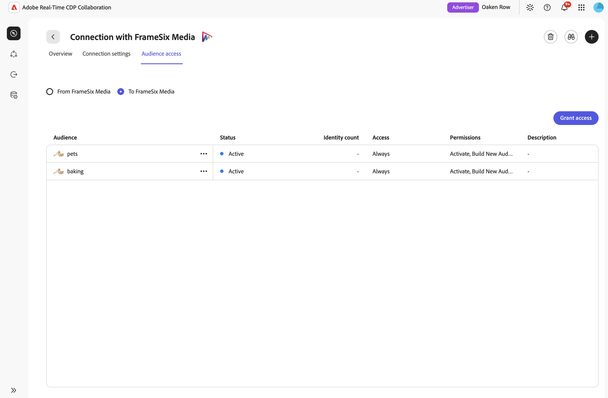

# RMN에 대한 가상 대상 액세스(대상 부여) {#virtual-audience-access}

연결된 파트너와 대상을 공유하려면 [!DNL Adobe Real-Time CDP Collaboration]에서 가상 대상 액세스를 사용하세요. 대상 부여는 지속적 참조를 통해 파트너에게 전체 대상 모집단에 대한 액세스 권한을 부여합니다. 소유권은 그대로 유지되며 액세스 권한을 부여할 때 대상 데이터가 이동하지 않습니다.

공유 대상을 사용하려면 인벤토리에서 가상 대상을 찾습니다. 권한 부여 내에서 활성화 또는 집단 대상 생성을 위해 대상을 사용합니다. 예를 들어 RMN(소매 미디어 네트워크)은 광고주에게 집단 대상 생성 및 활성화를 위한 액세스 권한을 부여할 수 있습니다.

## 대상자 액세스 개념 {#audience-access-concepts}

공유하는 내용과 파트너가 대상자를 사용하는 방법을 이해하려면 다음 용어를 검토하십시오.

| 용어 | 설명 |
| --- | --- |
| 공급자 | 대상자를 소유하고 액세스를 제어하는 조직입니다. |
| 수신자 | 대상자에 대한 액세스 권한을 받는 연결된 파트너입니다. |
| 부여 | 허용된 사용 및 액세스 기간을 포함하여 공유 대상자에 대한 액세스. |
| 가상 대상 | 수신자 인벤토리에서 사용할 수 있는 공급자 소유 대상에 대한 영구 참조. |
| 전체 모집단 | 전체 대상 모집단에 대한 액세스 권한을 부여하는 공유. |
| 연결 범위 | 단일 프로젝트가 아닌 공급자와 수신자 간의 연결에 적용되는 액세스 권한. |

{style="table-layout:auto"}

공유 대상을 활성화하려면 직접 활성화 권한이 필요합니다.

가상 대상 액세스는 연결에 적용됩니다. 프로젝트 내에서 공유하는 것은 별도의 워크플로우이며 수신자 인벤토리에 가상 대상을 추가하지 않습니다.

기존 공동 작업 프로젝트를 통해 대상을 활성화하려면 [프로젝트에서 대상 보내기 및 활성화](/help/guide/collaborate/activate.md)를 참조하십시오.

## 사전 요구 사항 {#prerequisites}

가상 대상 액세스 권한을 부여하거나 사용하기 전에 다음 요구 사항을 충족하는지 확인하십시오.

* 가상 대상 부여의 경우 공동 작업자와 활성 [연결을 설정하십시오](/help/guide/connect/establishing-connections.md).
* 대상을 제공하는 경우 해당 대상을 공유할 수 있는지 확인하십시오.
* 사용 가능한 작업을 확인하려면 나와 공유된 대상자에 대한 권한 부여 를 검토하십시오.

**[!UICONTROL 대상자 공유]** 대화 상자에 다음 권한이 표시됩니다. 두 권한이 모두 선택되어 있으며 편집할 수 없습니다.

| 대상자 권한 | 허용된 사용 |
| --- | --- |
| 직접 활성화 | 대상이 활성화 요구 사항을 충족하면 프로젝트 없이 대상에 대한 공유 대상을 활성화합니다. |
| [!UICONTROL 새 대상 작성] | 대상을 작성할 때 공유 대상을 입력으로 사용합니다. |

{style="table-layout:auto"}

## 대상자 공유 {#share-an-audience}

연결된 파트너에게 선택한 대상자에 대한 액세스 권한을 부여하려면 전체 모집단에 대한 액세스 권한을 부여하고 허용된 사용 및 기간을 설정합니다. 액세스 권한을 부여해도 대상이 활성화되지 않습니다.

먼저 **[!UICONTROL 연결]** 작업 영역과 받는 사람 연결을 엽니다.

그런 다음 **[!UICONTROL 대상자 액세스]**&#x200B;를 선택하고 파트너와 공유하는 대상자에 대한 옵션을 선택합니다.

옵션에는 파트너 이름이 포함됩니다. 이 예제에서는 **[!UICONTROL To FrameSix Media]**&#x200B;를 선택합니다.

그런 다음 **[!UICONTROL 액세스 권한 부여]**&#x200B;를 선택하여 **[!UICONTROL 대상자 공유]** 대화 상자를 엽니다.

**[!UICONTROL 대상]**&#x200B;에서 **[!UICONTROL 대상 선택]**&#x200B;에서 대상을 선택하거나 **[!UICONTROL 대상 찾아보기]**&#x200B;를 선택하십시오.

선택한 대상자가 대화 상자에 나타납니다. 조직은 대상자에 대한 소유권과 관리를 유지합니다.

그런 다음 **[!UICONTROL 권한]**&#x200B;에서 표시된 권한을 검토하십시오. 직접 활성화 권한 을 사용하면 파트너가 가상 대상을 고유한 대상에 활성화할 수 있습니다. **[!UICONTROL 새 대상 만들기]**&#x200B;를 통해 파트너는 가상 대상을 사용하여 새 대상을 만들 수 있습니다. 두 권한이 모두 선택되어 있으며 편집할 수 없습니다.

그런 다음 **[!UICONTROL 액세스 기간]**&#x200B;의 **[!UICONTROL 기간]**&#x200B;에서 옵션을 선택하여 파트너가 액세스할 수 있는 기간을 설정하십시오. 만료 날짜 없이 액세스하려면 **[!UICONTROL 항상]**&#x200B;을(를) 선택하거나 제한 시간 액세스 날짜를 지정하십시오.

![대상 공유 대화 상자에 선택한 대상, 선택한 사용 권한 및 [항상]으로 설정된 기간이 표시됩니다.](../../assets/setup/virtual-audience-access/share-audiences-duration.png)

마지막으로 선택한 대상, 권한 및 액세스 기간을 검토한 다음 **[!UICONTROL 액세스 권한 부여]**&#x200B;를 선택합니다.

**[!UICONTROL 대상자 액세스]** 탭에는 공유 대상자의 상태, ID 수, 액세스 기간, 권한 및 설명이 나열됩니다.

공유 대상도 수신자 인벤토리에 가상 참조로 표시됩니다. 소유권은 그대로 유지됩니다. 부여에서 활성화를 허용하는 경우 수신자는 대상을 별도로 활성화할 수 있습니다.

## 공유 대상자 찾기 및 사용 {#find-and-use-shared-audiences}

받는 사람은 공급자 연결의 **[!UICONTROL 대상 액세스]** 탭에서 공유 대상을 찾습니다. 권한 부여 내에서 각 대상자를 사용합니다.

### 공유 대상자 찾기 {#find-shared-audiences}

공급자가 공유하는 대상을 찾아 액세스 세부 사항을 검토하려면 공급자 연결을 여십시오. 먼저 **[!UICONTROL 연결]** 작업 영역과 공급자 연결을 엽니다.

그런 다음 **[!UICONTROL 대상자 액세스]**&#x200B;를 선택하고 공급자가 공유하는 대상자에 대한 옵션을 선택합니다.

옵션에는 공급자 이름이 포함됩니다. 이 예제에서는 **[!UICONTROL FrameSix 미디어에서]**&#x200B;을(를) 선택합니다.

마지막으로 공유 대상자 및 해당 액세스 세부 사항을 검토합니다.

### 대상자 빌드 {#build-audiences}

공유 대상에서 대상을 만들려면 **[!UICONTROL 새 대상 만들기]** 권한이 필요합니다. 예를 들어 공유 대상을 고유한 대상과 결합하여 새 대상을 만듭니다.

새 대상은 사용자의 것입니다. 공급자는 소스 대상의 소유권을 유지합니다.

### 공유 대상자 활성화 {#activate-shared-audiences}

가상 대상을 직접 활성화하려면 부여가 다음 조건을 충족하는지 확인하십시오.

| 요구 사항 | 조건 |
| --- | --- |
| 공유 유형 | 전체 모집단 |
| 대상자 권한 | 대상자에 대한 직접 활성화 권한이 있습니다. |
| 상태 부여 | 활성. 액세스가 무기한이거나 지정된 날짜 범위 내에 있습니다. |

{style="table-layout:auto"}

대상자를 대상으로 보내려면 **[!UICONTROL 활성화]** 페이지를 사용하십시오. 프로젝트가 필요하지 않습니다.

자세한 내용은 [직접 대상자 활성화(Beta)](/help/guide/destinations/direct-audience-activation.md)를 참조하십시오.

대상이 요구 사항을 충족하지 않으면 직접 활성화할 대상을 선택할 수 없습니다. Collaboration은 예약된 활성화 실행 시마다 자격 조건을 다시 확인합니다.

## 대상자 액세스 관리 {#manage-audience-access}

공급자는 액세스 지속 시간을 제어합니다. 권한 부여 만료를 변경하거나 액세스 권한을 취소할 수 있습니다.

### 액세스 기간 {#access-duration}

권한 부여 생성 시 액세스 기간을 선택합니다.

| 지속 시간 | 행동 |
| --- | --- |
| [!UICONTROL 항상] | 액세스에는 자동 만료가 없습니다. 권한 부여를 취소할 수 있습니다. |
| 날짜 범위 | 액세스는 지정된 날짜 범위 동안 지속됩니다. Collaboration은 만료 시간을 시간별로 처리합니다. |

{style="table-layout:auto"}

액세스를 확장하려면 향후 만료 날짜를 설정하거나 기간을 무제한 액세스로 변경하십시오. 둘 중 하나를 변경하면 만료된 부여도 다시 활성화됩니다.

### 액세스 만료 {#access-expiration}

Collaboration은 시간별로 만료된 부여를 확인합니다. Collaboration이 부여를 만료된 것으로 표시하면 수신자는 대상에 대한 가상 액세스 권한을 잃게 됩니다.

### 액세스 취소 {#revoke-access}

가상 액세스를 즉시 제거하려면 활성 또는 만료된 부여를 취소하십시오.

## 다음 단계 {#next-steps}

대상자 액세스 권한을 부여하거나 받은 후 다음 안내서를 사용하여 활성화를 준비하거나 Collaborator 연결을 관리합니다.

* [대상 구성 및 관리](/help/guide/destinations/manage-destinations.md)
* [Collaborator 연결 관리](/help/guide/connect/manage-connections.md)
